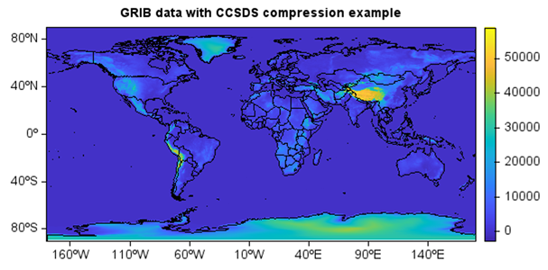
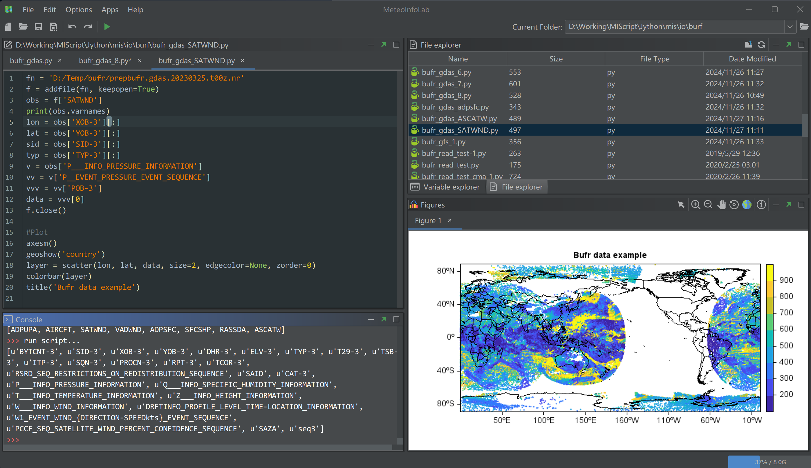

.. _news-meteoinfo_4.0:

******************************************
MeteoInfo 4.0 was released (2025-3-26)
******************************************

  - Support GRIB data with CCSDS compression
  - Better Bufr data support including multi-category messages in one data file
  - Support avoiding collapse of x-axis labels in ProjLonLatAxis class
  - Add `fft` package for fast fourier transformation
  - Add `frombuffer` function to create ndarray object
  - Add cross_section function in meteolib package
  - Update XYZ tile layer base URL similar with QGIS
  - Update netcdf-java to version 5.8.0-SNAPSHOT
  - Update flatten and ravel functions
  - Update WebImage plot function
  - update Jython to version 2.7.4;
  - update flatlaf to version 3.5.4
  - Some other bugs fixed

Fast Fourier Transformation example
____________________________________

::

    #Read image
    fn = os.path.join(migl.get_sample_folder(), 'image', 'Lenna.png')
    lena = imagelib.imread(fn)
    img = imagelib.gray_scale(lena)[:,:,0]

    #FFT
    f = np.fft.fft2(img)
    fshift = np.fft.fftshift(f)
    res = np.log(np.abs(fshift))

    #Invert FFT
    ishift = np.fft.ifftshift(fshift)
    iimg = np.fft.ifft2(ishift)
    iimg = np.abs(iimg)

    #Plot
    subplot(1,3,1,axis=False,aspect='equal')
    imshow(img, cmap='cmocean_gray'), title('Original Image')
    subplot(1,3,2,axis=False,aspect='equal')
    imshow(res, cmap='cmocean_gray'), title('Fourier Image')
    subplot(1,3,3,axis=False,aspect='equal')
    imshow(iimg, cmap='cmocean_gray'), title('Inverse Fourier Image')

Read GRIB data with CCSDS compression
_____________________________________

::

    fn = r'D:/Temp/grib/ecmwf/20250106180000-0h-oper-fc.grib2'
    f = addfile(fn)
    data = f['Geopotential_surface'][0]

    axesm()
    geoshow('country')
    imshow(data)
    colorbar()
    title('GRIB data with CCSDS compression example')

Read prepbufr data file
__________________________

::

    fn = 'D:/Temp/bufr/prepbufr.gdas.20230325.t00z.nr'
    f = addfile(fn, keepopen=True)
    obs = f['SATWND']
    print(obs.varnames)
    lon = obs['XOB-3'][:]
    lat = obs['YOB-3'][:]
    sid = obs['SID-3'][:]
    typ = obs['TYP-3'][:]
    v = obs['P___INFO_PRESSURE_INFORMATION']
    vv = v['P__EVENT_PRESSURE_EVENT_SEQUENCE']
    vvv = vv['POB-3']
    data = vvv[0]
    f.close()

    #Plot
    axesm()
    geoshow('country')
    layer = scatter(lon, lat, data, size=2, edgecolor=None, zorder=0)
    colorbar(layer)
    title('Bufr data example')

